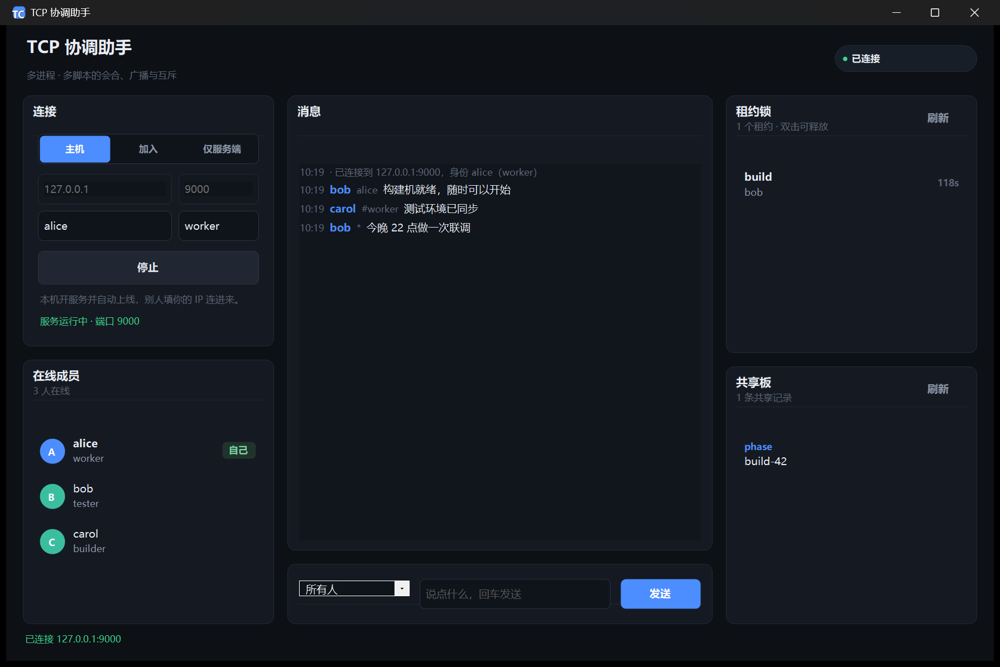

# TCP 协调助手

一个跑在 Windows 上的轻量「协调中枢」：让多个进程、脚本、程序在同一个 TCP 端口上
**互相发现、点名通信、抢占租约锁、共享少量状态**。

自带桌面界面，**双击就能用，不需要安装 .NET SDK，也不需要任何第三方依赖**。



---

## 它解决什么问题

你有一堆互相独立的程序（采集进程、构建机、测试脚本、小工具），它们需要：

- 知道**彼此在不在线**（谁起来了、谁挂了）
- 能**互相喊话**（点对点、按角色、全体广播）
- 保证**同一时刻只有一个**干某件事（比如只有一个进程去发布）
- 交换一点**共享状态**（当前阶段、构建号）

这些用数据库或消息队列都太重。TCP 协调助手就是一个几百 KB 的小程序：
一个进程当主机开个端口，其余进程连上来登记个名字，剩下的都好办。

## 功能

| 能力 | 说明 |
|---|---|
| 在线成员 | 名字全局唯一，上线/下线自动广播，断线立即从名单消失 |
| 消息路由 | `点名` / `#角色` 群发 / `*` 全体广播 |
| 租约锁 | 带 TTL 的互斥锁，抢不到会告诉你谁占着、还剩几秒；持有者掉线自动释放 |
| 共享板 | 小的键值存储，适合放「当前阶段 = 联调」这类状态 |
| 保活 | 服务端空闲发 `PING`，超时踢人，不会留下僵尸成员 |
| 桌面界面 | 会员列表、聊天流、锁列表、共享板一屏看完，支持中英文 |
| 命令行 | 同一份代码带一个控制台版服务端 + 交互式客户端，适合无人值守 |

## 快速开始

### 方式一：直接运行（推荐）

1. 下载 [`dist/TcpCoordinator-win64.zip`](dist/TcpCoordinator-win64.zip) 解压
2. 双击 `TcpCoordinatorApp.exe`
3. 点 **启动服务** —— 程序会监听 `9000` 并自动连上
4. 其他机器 / 其他程序：填你的 IP + `9000`，写个名字和角色，点 **连接**

> 系统要求：Windows 10 / 11（自带 .NET Framework 4.x 即可）。

### 方式二：从源码编译

需要 Windows 自带的 `csc.exe`（.NET Framework 4.x 装好就有，无需额外下载）：

```bat
build.cmd
```

产物在 `dist\`。也可以手动：

```bat
csc /target:winexe /main:TcpCoordinatorApp.Program /win32icon:assets\app.ico ^
    /out:dist\TcpCoordinatorApp.exe /r:System.Windows.Forms.dll /r:System.Drawing.dll ^
    src\CoordinatorApp.cs src\TcpCoordinator.cs
```

### 方式三：只用命令行

```bat
:: 开服务端
dist\TcpCoordinator.exe --port 9000

:: 以客户端身份连上去，进交互模式
dist\TcpCoordinator.exe --connect 127.0.0.1:9000 --name alice --role worker
```

## 三种工作模式

界面顶部有一个模式切换，决定这台机器扮演什么角色：

| 模式 | 行为 | 适用 |
|---|---|---|
| **主机** | 本机监听端口，并以填写的名字自动上线 | 一台机器当会合点，别人连过来 |
| **加入** | 只作为客户端连到别人的地址 | 加入已有的协调中枢 |
| **仅服务端** | 只监听端口，不以成员身份上线 | 后台常驻的纯中枢，自己用命令行或别的程序连 |

主机模式下地址固定为 `127.0.0.1`、端口在服务运行期间会**锁定不可改**——避免"界面上的端口"和"实际监听的端口"不一致这种坑。

## 连不上怎么排查

`由于目标计算机积极拒绝，无法连接` 表示**对端端口上没有程序在监听**（不是防火墙拦截，防火墙通常是超时）。按顺序核对：

```powershell
# 1. 主机端确认真的在监听（应看到 0.0.0.0:<端口>）
Get-NetTCPConnection -State Listen | Where-Object LocalPort -eq 9000

# 2. 拿局域网 IP（别人要填这个，不是 127.0.0.1）
ipconfig | Select-String 'IPv4'

# 3. 主机端放行防火墙（管理员 PowerShell，仅一次）
netsh advfirewall firewall add rule name="TCP协调助手" dir=in action=allow protocol=TCP localport=9000

# 4. 客户端侧先探通不通，TcpTestSucceeded 必须为 True
Test-NetConnection 对方IP -Port 9000
```

第 4 步不通就说明 1~3 有问题，此时在界面里点「连接」只会得到同一个错误。

## 用任何语言接进来

协议是 **UTF-8 文本行**，一行一条命令，用 `netcat` 或者任意语言的 socket 都能说：

```text
← WELCOME c1 TcpCoordinator/1.0
→ HELLO alice worker
← OK hello alice worker
← PEERS 1 alice:worker
→ SAY bob 你好
← OK say 1
← MSG bob tester alice 你也好
```

PowerShell 里最省事的验证方式：

```powershell
$c = New-Object Net.Sockets.TcpClient('127.0.0.1', 9000)
$s = $c.GetStream()
$w = New-Object IO.StreamWriter($s, [Text.UTF8Encoding]::new($false)); $w.NewLine = "`n"; $w.AutoFlush = $true
$r = New-Object IO.StreamReader($s, [Text.UTF8Encoding]::new($false))
$w.WriteLine('HELLO bob tester')
$r.ReadLineAsync().Wait(2000) | Out-Null; $r.ReadLineAsync().Wait(2000) | Out-Null
$w.WriteLine('LOCK build 120')
$r.ReadLine()   # OK lock build 120
```

### 协议速查

**客户端 → 服务端**

| 命令 | 作用 |
|---|---|
| `HELLO <name> [role]` | 登记（连接后必须先做，名字全局唯一） |
| `LIST` | 列出在线成员 |
| `SAY <to> <text>` | 发消息，`to` 可以是名字、`#角色`、`*` |
| `WHOAMI` | 查自己的身份 |
| `LOCK <key> [ttl]` | 抢租约锁，默认 60 秒，范围 5~3600 |
| `UNLOCK <key>` | 释放自己的锁 |
| `LOCKS` | 列出有效锁 |
| `SET <key> <value>` / `GET <key>` / `DEL <key>` / `BOARD` | 共享板读写 |
| `PING` / `QUIT` | 心跳 / 退出 |

**服务端 → 客户端**

| 响应 | 含义 |
|---|---|
| `WELCOME <connId> TcpCoordinator/1.0` | 连接建立 |
| `OK <cmd> ...` / `ERR <code> ...` | 成功 / 失败 |
| `PEERS <count> <name:role> ...` | 成员名单 |
| `PRESENCE <join\|leave> <name> <role>` | 有人上下线 |
| `MSG <from> <role> <target> <text>` | 收到消息 |
| `LOCKS <n>` / `LK <key> <owner> <ttl>` / `END` | 锁列表（多行，以 END 结束） |
| `BOARD <n>` / `KV <key> <value>` / `END` | 共享板（多行，以 END 结束） |
| `BYE <reason>` | 服务端断开你 |

常见错误码：`hello_required`、`name_taken`、`unknown_peer`、`locked`、`not_owner`、
`not_locked`、`bad_key`、`bad_ttl`、`unknown_command`、`server_full`。

## 目录结构

```text
TcpCoordinator/
├─ src/
│  ├─ TcpCoordinator.cs     协议服务端 + 命令行客户端（约 1800 行）
│  └─ CoordinatorApp.cs     WinForms 桌面界面（约 1900 行，自绘控件）
├─ assets/                  截图与图标
├─ dist/                    编译好的程序（Windows x64）
├─ build.cmd                一键编译
└─ README.md
```

## 设计说明

- **零依赖**：只用了 .NET Framework 自带的 `System.dll` / `System.Windows.Forms.dll` /
  `System.Drawing.dll`，不需要 NuGet，也不需要联网。
- **单文件可编译**：两个 `.cs` 互不依赖第三方，`csc` 一条命令出结果。
- **桌面程序内嵌服务端**：点「启动服务」会在同进程起一个 TCP 监听，所以一台机器就能完成
  「主机 + 客户端」的完整体验，不用先开控制台。
- **界面全部自绘**：卡片、按钮、输入框、状态胶囊都是 `Control` 子类手绘，
  没有设计器文件和外部资源，主题集中在一个 `Theme` 类里。
- **DPI 感知**：在 125% / 150% 缩放的屏幕上按物理像素渲染，不糊；窗口尺寸按屏幕工作区收敛。

## 已知限制

- 仅支持 Windows（依赖 .NET Framework 4.x 与 WinForms）。
- **没有鉴权**：能连上端口的人都能参与。只建议在可信的内网 / 本机使用。
- 状态全在内存里，服务端进程重启后成员、锁、共享板都会清空。
- 成员规模是「几十个」量级，不是高并发消息中间件。

## License

[MIT](LICENSE)
